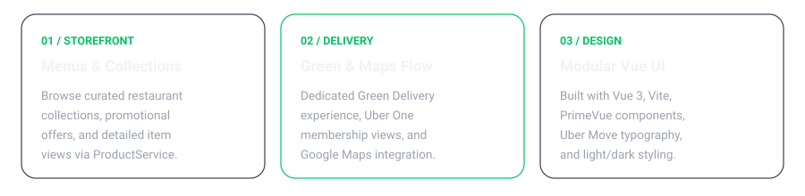
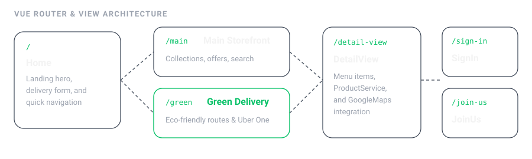

<p align="center">
  
</p>

<p align="center">
  <a href="https://deft-brioche-f529c6.netlify.app/">Live Demo (Netlify)</a> &middot;
  <a href="#installation">Installation</a> &middot;
  <a href="#architecture">Architecture</a> &middot;
  <a href="#project-structure">Project Structure</a>
</p>

---

## Overview

**UberEats-Delivery** is a front-end food delivery web application built with **Vue 3**, **Vite**, **Vue Router**, and **PrimeVue**. It models the core browsing and ordering flows of a modern delivery platform: restaurant discovery, curated collections, promotional offers, detailed menu views, Google Maps integration, and dedicated Green Delivery and Uber One views.

> **Note:** An earlier version of this README referenced React (`npm start` / `src/App.js`). The codebase is implemented with **Vue 3** and **Vite** (`npm run dev` / `src/main.js`).

---

## Features

<p align="center">
  
</p>

- **Restaurant & Menu Discovery**: Browse restaurant cards, curated collections, promotional offers, and detailed menu views (`DetailView.vue`, `ProductService.js`).
- **Green Delivery & Uber One**: Dedicated routes and views for eco-friendly delivery (`/green`, `greenDelivery.vue`) and membership (`/join-us`, `UberOne.vue`).
- **Map & Location Support**: Integrated `@fawmi/vue-google-maps` (`GoogleMaps.vue`) and delivery address form (`DeliveryForm.vue`).
- **Responsive Design**: Styled with `Uber Move` typography, `#06C167` delivery green accents, and `prefers-color-scheme` light/dark support.

---

## Architecture

<p align="center">
  
</p>

### Tech Stack

| Layer | Technology |
|---|---|
| Framework | Vue 3 (`^3.4.21`) |
| Build Tool | Vite (`^5.2.6`) |
| Routing | Vue Router (`^4.0.13`) |
| UI Components | PrimeVue (`^3.51.0`) |
| Maps | `@fawmi/vue-google-maps` (`^0.9.79`) |
| Deployment | Netlify / `gh-pages` (`^6.3.0`) |

---

## Screenshots

<details>
<summary><b>Home &amp; Restaurant Menu screenshots</b></summary>

<br/>

### Home Page


### Restaurant Menu Page


</details>

---

## Installation

```bash
git clone https://github.com/prth1234/UberEats-Delivery.git
cd UberEats-Delivery
npm install
npm run dev
```

<details>
<summary><b>Available npm scripts &amp; build commands</b></summary>

- `npm run dev` — Start the Vite development server (typically `http://localhost:5173`)
- `npm run build` — Production build into `dist/`
- `npm run preview` — Preview the production build locally
- `npm run deploy` — Build and deploy via `gh-pages`

</details>

---

## Project Structure

<details>
<summary><b>Explore repository layout (`src/views`, `src/components`, `src/router`)</b></summary>

```text
UberEats-Delivery/
├── index.html
├── package.json
├── public/
│   └── vite.svg
└── src/
    ├── App.vue                 # Root Vue component
    ├── home.vue                # Landing view (/)
    ├── main.js                 # Application entry point
    ├── style.css               # Global theme & Uber Move font tokens
    ├── router/
    │   └── router.js           # Vue Router configuration
    ├── components/
    │   ├── DeliveryForm.vue    # Address & delivery input
    │   ├── navbar.vue
    │   ├── logo.vue
    │   └── imageBar.vue
    └── views/
        ├── main.vue            # Main storefront (/main)
        ├── green.vue           # Green delivery (/green)
        ├── DetailView.vue      # Restaurant & menu details (/detail-view)
        ├── GoogleMaps.vue      # Map integration
        ├── ProductService.js   # Menu & product data service
        ├── UberOne.vue         # Membership view
        ├── joinus.vue          # Partner onboarding (/join-us)
        └── signin.vue          # Sign-in view (/sign-in)
```

</details>

---

## Contributing

Contributions are welcome:

1. Fork the repository.
2. Create a new branch for your feature or fix (`git checkout -b feature/your-feature`).
3. Commit your changes (`git commit -m "Add feature"`).
4. Push your branch and open a pull request.

---

## License

This project is licensed under the MIT License. See the `LICENSE` file if present in the repository for details.

---

## Contact

- **Name**: Parth
- **Email**: dearparthsingh@gmail.com
- **GitHub**: [prth1234](https://github.com/prth1234)
